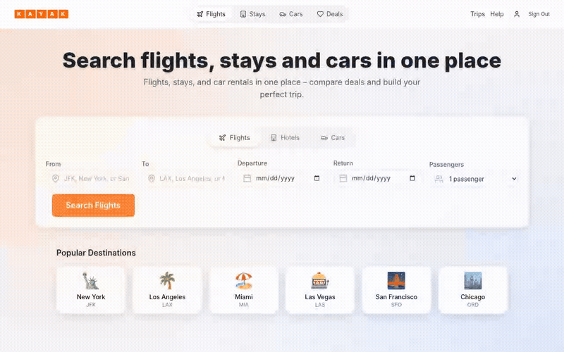

# Travel Booking Platform



Flight, hotel and car booking site built as Node and Python microservices that talk over Kafka.

```bash
git clone https://github.com/jayhemnani9910/travel-booking-platform.git && cd travel-booking-platform && npm ci && npm run build:shared && cd apps/client && VITE_DEMO_MODE=true npx vite --host
```

That runs the React client on http://localhost:3000 in demo mode, with mocked API responses and no backend. The GIF above is the same demo mode, recorded on the hosted copy.

Live demo: https://jayhemnani9910.github.io/travel-booking-platform/

## Run the whole stack

```bash
npm ci && npm run build:shared
cp .env.example .env
docker compose up -d --build
```

These are the steps CI runs. They start 13 backend services, the client, MySQL, MongoDB, Redis, ZooKeeper, Kafka and Nginx. The API gateway is on http://localhost:8000 and the client on http://localhost:3000. CI builds these images and checks `http://localhost:8000/health` on every push.

The concierge service calls a local Ollama model (`qwen2.5:3b` by default) at `host.docker.internal:11434`. Payments use Stripe test keys from `.env`.

For a cluster, there are Kubernetes manifests in `infra/k8s/`.

## How it works

The client talks only to the API gateway. The gateway proxies `/api/*` to each service, with a circuit breaker per service.

A booking is a saga in `booking-svc`. It reserves the flight, hotel or car over HTTP and records a compensation for each step. If a later step fails, it runs the compensations in reverse. It also listens on the `payment.events` Kafka topic and cancels the reservations when a payment fails.

Deals go through a Kafka pipeline: `deals.raw`, `deals.normalized`, `deals.scored`, `deals.tagged`. The topics are defined in `platform/kafka/`.

## Services

| Service | Language | What it does |
|---------|----------|--------------|
| `api-gateway` | TypeScript | Routing, auth, circuit breakers |
| `user-svc` | TypeScript | Sign up, login, profiles |
| `flights-svc` | TypeScript | Flight search and reservations |
| `hotels-svc` | TypeScript | Hotel search and reservations |
| `cars-svc` | TypeScript | Car rental search and reservations |
| `booking-svc` | TypeScript | Booking saga |
| `billing-svc` | TypeScript | Stripe payments |
| `notification-svc` | TypeScript | Email and SMS |
| `admin-svc` | TypeScript | Analytics for bookings, revenue, deals and users |
| `airport-resolver-svc` | TypeScript | Airport code and name lookup |
| `external-adapters` | TypeScript | Third-party API adapters |
| `deals-worker` | Python | Deal ingestion |
| `concierge-svc` | Python | Chat assistant (FastAPI, Ollama) |
| `client` | React, Vite | Web app |

`airport-resolver-svc` is not in `docker-compose.yml`.

## Layout

```
apps/       one folder per service, plus the client
shared/     shared types, models and validators
platform/   Kafka topics, MongoDB and MySQL schemas
infra/      Kubernetes manifests and Nginx config
scripts/    build and dev scripts
tests/      e2e, performance (k6), unit, seed data
data/       airport data
```

## Tests

```bash
npm ci
npm run build:shared
npm test
```

Some suites need MySQL and Redis running, and several fail today. See [CONTRIBUTING.md](CONTRIBUTING.md).

## Contributing

See [CONTRIBUTING.md](CONTRIBUTING.md).
